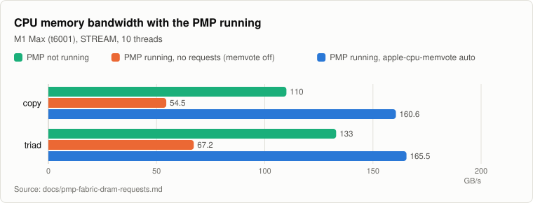
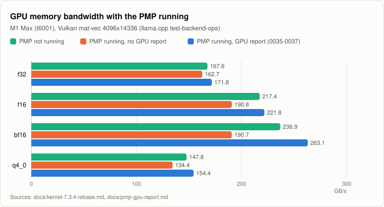
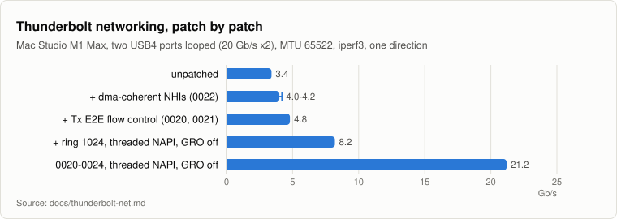
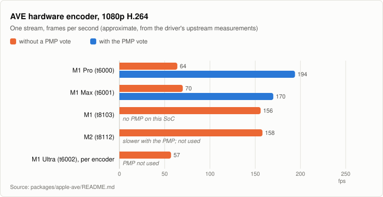

# apple-silicon-kernel-plus

RPM packages for Fedora Asahi Remix on Apple silicon Macs, built and
hosted in the COPR
[`aquarat/apple-silicon-kernel-plus`](https://copr.fedorainfracloud.org/coprs/aquarat/apple-silicon-kernel-plus/)
(Fedora 44, aarch64):

- **a kernel** from the Asahi Linux tree (Linux 7.3.4), packaged like
  Fedora's `kernel-16k`, with Thunderbolt/USB4 host support, NVMe in
  Thunderbolt enclosures, fast Thunderbolt networking between Macs, KVM
  support for macOS guests, and power-management (PMP) patches that give
  M1 Pro/Max their full memory bandwidth with the PMP's power saving;
- **video drivers**: the AVD decoder with fixes for long-running streams,
  and an AVE hardware encoder driver (H.264/HEVC);
- **userspace**: patched Vulkan drivers, and QEMU for macOS guests with
  their paravirtual GPU as a separate program.

**Unofficial.** This project is not affiliated with or endorsed by Asahi
Linux, Fedora or Apple. Do not report bugs from these packages to Asahi
Linux or Fedora; report them here.

## Packages

| package | what | status | in COPR |
|---|---|---|---|
| `kernel` (`kernel-16k-*`) | Linux 7.3.4 from the Asahi tree with this project's patches ([below](#the-kernel)). [packages/kernel](packages/kernel) | **experimental** ([why](packages/kernel/README.md)) | yes, `7.3.4-900.asahiwip.plus5` |
| `apple-silicon-thunderbolt` | udev rules: NVMe power-state transitions (APST) off for drives in Thunderbolt enclosures (they drop the USB4 link otherwise), threaded NAPI with GRO off for Thunderbolt networking. [packages/apple-silicon-thunderbolt](packages/apple-silicon-thunderbolt) | experimental | yes, `1.1-1` |
| `dkms-apple-avd` | The Asahi AVD video decoder driver with fixes for long-running streams, built by DKMS. [packages/apple-avd](packages/apple-avd) | stable | yes, `7.3.1.2-1` |
| `apple-ave`, `dkms-apple-ave` | A V4L2 H.264/HEVC encoder driver for the AVE block, reverse engineered, and `apple-ave-fetch-firmware`, which makes its firmware files on your Mac from Apple's own image. No Apple firmware or Apple data included. [packages/apple-ave](packages/apple-ave) | **experimental** ([why](packages/apple-ave/README.md#status)) | yes, `0.99.6-3` |
| `mesa-honeykrisp-plus` | Mesa's Asahi Vulkan driver (Honeykrisp) with two shader compiler fixes, installed beside the system Mesa and used only through `VK_DRIVER_FILES`. Patch 0002 is still being validated. [packages/mesa-honeykrisp-plus](packages/mesa-honeykrisp-plus) | stable (0002: in validation) | yes, `26.2.4-2` |
| `mesa-coopmat` | Mesa's Asahi Vulkan driver from the `coopmat` branch of [aquarat/mesa](https://github.com/aquarat/mesa) (Mesa main + `VK_KHR_cooperative_matrix`), pinned to one commit, for GPU compute through ggml (llama.cpp, stable-diffusion.cpp). Its own versioned directory, opt-in per process with `with-coopmat <command>`; the system Mesa stays the default. [packages/mesa-coopmat](packages/mesa-coopmat) | experimental (new package) | an older pin, `26.3.0~devel^20260906git71969e3-1` (main's `20e478a` not built yet) |
| `qemu-vmapple` | QEMU with the `vmapple` machine for macOS guests, installed beside Fedora's qemu. Its paravirtual GPU runs out of process (`apv-gpu-proxy` forwards it to `reims-vgpu-backend`). [packages/qemu-vmapple](packages/qemu-vmapple) | experimental (in production use since 2026-10-19) | not yet (first build running) |
| `reims-vgpu-backend` | Reims, the paravirtual GPU of macOS guests, as its own program: runs the guest's Metal work on the host's Vulkan driver (with `mesa-honeykrisp-plus`), for `qemu-vmapple`. [packages/reims-vgpu-backend](packages/reims-vgpu-backend) | experimental (in production use since 2026-10-19) | not yet (first build running) |

"In COPR" is the newest successful build for `fedora-44-aarch64` when this
README was last updated; the
[COPR's package list](https://copr.fedorainfracloud.org/coprs/aquarat/apple-silicon-kernel-plus/packages/)
is always current. (`qemu-vmapple-kvm-nisv` is retired: an empty package
now, see [its README](packages/qemu-vmapple/README.md#qemu-vmapple-kvm-nisv-retired).)

## Install

```sh
sudo dnf copr enable aquarat/apple-silicon-kernel-plus
sudo dnf upgrade                      # moves you to this project's kernel (see below)
sudo dnf install dkms-apple-avd       # and/or: apple-ave, mesa-honeykrisp-plus, mesa-coopmat,
                                      #   apple-silicon-thunderbolt, qemu-vmapple (recommends reims-vgpu-backend)
```

DKMS packages need `kernel-16k-devel` for each installed kernel.

**Enabling this COPR moves you to this project's kernel, and that kernel is
experimental.** It is built from the Asahi Linux kernel tree, usually newer
than the one `@asahi` ships, and sorts as newer than every `@asahi` kernel
of the same or an older Linux version, so `dnf upgrade` installs it and
makes it the default boot entry. Read [Rollback](#rollback) before you do:
going back to a stock kernel of an older Linux version needs one extra
step.

## The kernel

`7.3.4-900.asahiwip.plus5`: Fedora's `kernel-16k` packages (Fedora's
`kernel.spec` and configuration with `@asahi`'s configuration on top),
built from the Asahi Linux tree's `asahi-wip` branch at `201be96df565`
(Linux 7.3.4), plus:

| area | patches | what | document |
|---|---|---|---|
| Thunderbolt/USB4 | (Asahi tree) | the host driver, built as modules; USB3 tunnels and XDomain; no DisplayPort tunnels | [packages/kernel](packages/kernel/README.md#thunderbolt-in-this-kernel) |
| NVMe in Thunderbolt enclosures | 0010-0013 | `pcie-apple-apciec`: PCIe tunnels on M1 Pro/Max/Ultra | [thunderbolt-pcie-apciec.md](docs/thunderbolt-pcie-apciec.md) |
| Thunderbolt networking | 0020-0027 | flow control, coherent DMA, a lost wakeup, an Rx page pool, per-machine UIDs, forwarding TSO packets across a bridge, TSO with a lowered MSS: about 3 to 21 Gb/s | [thunderbolt-net.md](docs/thunderbolt-net.md), [thunderbolt-net-tso-forwarding.md](docs/thunderbolt-net-tso-forwarding.md) |
| macOS guests (KVM) | 0001-0002 | Apple PAuth state for guests; MMIO loads/stores without a syndrome (both on) | [kvm-macos-guests.md](docs/kvm-macos-guests.md) |
| power management (PMP) | 0030-0037 | fabric/DRAM bandwidth requests and the GPU's power-state report ([below](#power-management-pmp)) | [pmp-fabric-dram-requests.md](docs/pmp-fabric-dram-requests.md), [pmp-gpu-report.md](docs/pmp-gpu-report.md) |
| config | | `CONFIG_VIDEO_APPLE_MSR=m` (Apple's MSR scaler, new in the 7.3.4 tree) and the options the patches need | [packages/kernel](packages/kernel/README.md#configs) |

The AQC113 10GbE fix of earlier releases (0003) is no longer carried: the
7.3.4 tree fixes it itself. Every patch has a document in
[docs/](docs/README.md); the 7.3.1 to 7.3.4 move is in
[kernel-7.3.4-rebase.md](docs/kernel-7.3.4-rebase.md).

## Power management (PMP)

The power management coprocessor (PMP) of the M1 Pro and M1 Max sets the
SoC, fabric and DRAM-controller performance states. Asahi's `pmp` driver
can start it, and running it saves about 1.3 W on an M1 Max laptop, idle
or busy. But nothing in Linux asked it for bandwidth, so with the PMP
running, CPU memory bandwidth halved and the GPU lost 3-20 % on
memory-bound work. Patches 0030-0037 fix both:

- **0030-0034, CPU and encoder bandwidth requests.** `pmp-report` gains a
  request interface to the PMP's dashboard (0030, 0031); an interconnect
  provider, `apple-pmp-icc`, turns bandwidth into fabric/DRAM levels per
  agent (0032, 0033); and `apple-cpu-memvote` asks for bandwidth for a CPU
  cluster while it misses its L1 cache often (0034; `mode=auto|off|force`).
  `apple-ave` votes for the encoder through the same provider. 10-thread
  STREAM on an M1 Max: 55 GB/s with the PMP running and no requests,
  about 160 with them (110 with the PMP not running), with no measurable
  cost at idle or under compute-bound load.
- **0035-0037, the GPU's report.** The PMP raises fabric and DRAM for the
  GPU only when the GPU is reported powered on, and Asahi's t600x device
  trees had no report entry for it. 0037 adds one (`report@9`), which
  0036 sets while the GPU driver is bound (setting it before the GPU
  firmware boots hung an M1 Max); 0035 is its binding. GPU mat-vec bf16
  on an M1 Max: 191 to 263 GB/s (237 with the PMP not running).

| SoC | machines | status |
|---|---|---|
| t6000 M1 Pro | MacBook Pro 14"/16" | validated on a 14" (CPU requests, GPU report, encoder vote) |
| t6001 M1 Max | MacBook Pro 14"/16", Mac Studio | validated on a 14" MacBook Pro; not yet run with the PMP on a Mac Studio |
| t6002 M1 Ultra | Mac Studio | not supported yet: no provider, GPU report entry removed; the PMP has not been run on a two-die machine (die 1 untested) |
| t8112 M2 | | not supported: no provider; in a test its PMP firmware crashed unless the neural engine stayed powered, and the encoder was slower with the PMP |
| t8103 M1, M2 Pro/Max/Ultra and later | | not covered (t8103 has an older PMP without Asahi support) |

**What it takes to turn on.** On a machine without the PMP running, these
patches do nothing (nothing is written, nothing is sampled), and that is
the default: the PMP runs only when m1n1's stage 2 (`m1n1/boot.bin` on the
EFI partition) carries device trees built with `APPLE_USE_PMP`. m1n1 then
copies the PMP's tunables from Apple's device tree and enables the node.
Fedora's device trees are built without it, and `update-m1n1` writes them
as they are. So activation means rebuilding the stage 2 with PMP-enabled
device trees for your board, which changes your boot path: a bad image is
recovered from macOS recovery (copy the previous `boot.bin` back). This
repository does not yet ship a tool for that step.

## Benchmarks

Measured on real machines and taken from the documents in `docs/`; all
charts, tables and their sources: [docs/benchmarks.md](docs/benchmarks.md).

<picture>
  <source media="(prefers-color-scheme: dark)" srcset="docs/img/pmp-cpu-stream-dark.svg">
  
</picture>

CPU memory bandwidth on an M1 Max: the PMP alone halves it, the CPU
requests (0030-0034) more than restore it
([pmp-fabric-dram-requests.md](docs/pmp-fabric-dram-requests.md)).

<picture>
  <source media="(prefers-color-scheme: dark)" srcset="docs/img/pmp-gpu-matvec-dark.svg">
  
</picture>

GPU memory bandwidth on an M1 Max with the GPU report (0035-0037)
([pmp-gpu-report.md](docs/pmp-gpu-report.md),
[kernel-7.3.4-rebase.md](docs/kernel-7.3.4-rebase.md)). On an M1 Pro the
two fixes together took the GPU from about 42 to 82-125 GB/s and 8-thread
STREAM from about 34 to 141-144 GB/s
([chart](docs/benchmarks.md#m1-pro-both-fixes-together)).

<picture>
  <source media="(prefers-color-scheme: dark)" srcset="docs/img/tbnet-loopback-dark.svg">
  
</picture>

Thunderbolt networking, patch by patch, over a 20 Gb/s x2 link
([thunderbolt-net.md](docs/thunderbolt-net.md)); Mac to Mac 21.4 Gb/s
single stream, and forwarding through a bridging Mac 19.1-19.5 Gb/s
([thunderbolt-net-tso-forwarding.md](docs/thunderbolt-net-tso-forwarding.md)).

<picture>
  <source media="(prefers-color-scheme: dark)" srcset="docs/img/ave-encode-dark.svg">
  
</picture>

The AVE hardware encoder, 1080p H.264, with and without the PMP vote
([packages/apple-ave](packages/apple-ave/README.md)). Also in
[benchmarks.md](docs/benchmarks.md): system power with the PMP, TSO
forwarding, and the AVD decoder's CPU time.

## Supported hardware

As the sources state; "tested" means on at least one machine of that SoC.

| package | SoCs |
|---|---|
| kernel | what the Asahi tree supports (M1 and M2 families). Thunderbolt/USB4: described by the Asahi device trees for t8103, t8112 and t600x; Thunderbolt networking tested Mac-to-Mac between t6001, t8103, t8112 and t6002, including a Mac bridging its 10GbE port and Thunderbolt ports for other Macs; PCIe tunnels on t600x with `pcie-apple-apciec` (tested on t6001, Mac Studio port 3, NVMe enclosure; known issues in [apple-silicon-thunderbolt-linux](https://github.com/aquarat/apple-silicon-thunderbolt-linux#status-and-known-issues)). The KVM PAuth patch acts only on M1 and M2 CPUs under VHE on bare metal; macOS guests tested on t6001 and t6002. PMP patches: t6000 and t6001 ([above](#power-management-pmp)) |
| dkms-apple-avd | M1 family (t8103, t6000, t6001, t6002); t8112: H.264 works, HEVC times out (open) |
| apple-ave | t6000, t8103 (H.264 without B frames), t8112; t6001 and t6002 after enabling them. All with the macOS 13.5 system firmware ([details](packages/apple-ave/README.md#supported-socs)) |
| mesa-honeykrisp-plus | M1 and M2 GPUs, as Mesa's Asahi driver |
| mesa-coopmat | M1 and M2 GPUs; run on t6001 (M1 Max) |
| qemu-vmapple | hosts that run the kernel above; macOS 13 and 26 guests used on t6001 and t6002 hosts |
| reims-vgpu-backend | M1 and M2 GPUs, with `mesa-honeykrisp-plus`; the out-of-process GPU used with macOS 26 guests on a t6002 host |

## Kernel release naming

The kernel is `<Linux version>-<N>.asahiwip.plus<M>.fc44`, now
`7.3.4-900.asahiwip.plus5.fc44` (`uname -r`:
`7.3.4-900.asahiwip.plus5.fc44.aarch64+16k`). `N` starts at 900 for each
Linux version, above any release number `@asahi` uses (400 and up), so for
the same Linux version this project's kernel sorts first; `plus<M>` goes up
when only this project's patches, configs or packaging change. The history
and the `rpmdev-vercmp` checks are in
[docs/kernel-release-naming.md](docs/kernel-release-naming.md).

Once `@asahi` publishes a kernel of a newer Linux version than this
project's, `dnf upgrade` offers `@asahi`'s, which has none of this
project's changes. To stay on this project's kernels, give the COPR
repository a higher priority:

```sh
sudo dnf config-manager setopt "copr:copr.fedorainfracloud.org:aquarat:apple-silicon-kernel-plus.priority=10"
```

## Rollback

Kernels are install-only: the previous ones stay installed and are listed
in the boot menu. **But do not boot a kernel of an older Linux version
than this project's newest installed kernel without switching the device
trees first.** m1n1 gives the kernel the device trees in the EFI
partition's `m1n1/boot.bin`, and `update-m1n1` writes the device trees of
the newest installed kernel there. The Asahi device trees change between
Linux versions: a 7.1 kernel booted with 7.2 (or later) trees hung in
testing before the network came up (the likely cause: the display
controller's IOMMU cells changed in 7.2), and other older-kernel, newer-tree
pairs are untested. So point `/boot/dtb` (what `update-m1n1` reads) at the
older kernel's own trees before you boot it:

```sh
sudo dnf copr disable aquarat/apple-silicon-kernel-plus
sudo dnf remove dkms-apple-avd apple-ave dkms-apple-ave mesa-honeykrisp-plus mesa-coopmat 'qemu-vmapple*' reims-vgpu-backend   # what you installed
dnf list --installed 'kernel-16k-core'          # is a stock (.asahi.fc44) kernel installed?
dnf list --available --showduplicates 'kernel-16k'   # if not: the stock versions @asahi offers
sudo dnf install kernel-16k-<version>.asahi.fc44     # one of them, e.g. kernel-16k-7.2.12-402.asahi.fc44
K=<version>.asahi.fc44.aarch64+16k              # the stock kernel's release, as in /boot/vmlinuz-*
sudo ln -sfn "dtb-$K" /boot/dtb && sudo update-m1n1   # boot.bin now has that kernel's device trees
sudo grubby --set-default "/boot/vmlinuz-$K"
sudo reboot
# after booting the stock kernel:
sudo dnf remove $(rpm -qa 'kernel-16k*' | grep '\.asahiwip\.')
sudo dnf remove $(rpm -qa 'kernel-16k*' | grep '\.asahi\.plus[0-9]')   # older kernels of this project, if any
sudo dnf distro-sync
```

If an older kernel was booted with newer device trees and hangs: the
previous image is kept as `m1n1/boot.bin.old` on the EFI partition. In
macOS recovery (hold the power button, Options, Terminal), mount the EFI
partition of the Asahi install (`diskutil list`, `diskutil mount diskXsY`)
and copy `boot.bin.old` over `boot.bin`.

Keeping an older kernel's device trees on purpose: setting
`DTBS=/usr/lib/modules/<older kernel>/dtb` in `/etc/sysconfig/update-m1n1`
makes every kernel boot with those trees, so that kernel stays safe to
boot. Newer kernels may then miss nodes they need: this project's 7.2
kernel booted with 7.1-based trees in testing (on a headless machine), but
without Thunderbolt, which needs the 7.2 trees' nodes.

## Using the KVM patches (macOS guests)

**macOS licence.** These packages contain no macOS software: you install
macOS in a guest from your own copy. macOS guests remain subject to Apple's
macOS software licence agreement, whose virtualisation terms allow macOS
virtual machines only on Apple-branded hardware that is already running
the Apple Software (macOS). Running them on a Mac booted into Linux may
not meet those terms. You are responsible for complying with Apple's
licence; this project makes no claim that any particular use does.

Patch 0001 (PAuth VM-key context) is always active; it only affects guests
on Apple CPUs. Patch 0002 (emulation of MMIO loads/stores that fault without
an instruction syndrome, which macOS guests need because XNU accesses the
interrupt controller with such instructions) is **on by default** from the
7.2.11 kernel (it was off up to 7.1.13). Nothing needs installing or
setting; `qemu-vmapple-kvm-nisv` is retired.

Check: `cat /sys/module/kvm/parameters/emulate_nisv_ldst` prints `Y`.
On a stock kernel the file does not exist. To turn it off:
`kvm.emulate_nisv_ldst=0` on the kernel command line, or `echo N | sudo tee
/sys/module/kvm/parameters/emulate_nisv_ldst` until the next reboot. More
in [docs/kvm-macos-guests.md](docs/kvm-macos-guests.md).

## Firmware for the AVE encoder

No Apple firmware, and no data taken from Apple's files, is in this
repository or its packages. `apple-ave-fetch-firmware` makes the files on
your Mac from your own copy of Apple's macOS 13.5 files (the kernelcache
the Asahi installer left on the EFI partition, plus a directory or a local
restore image), and checks each against known sha256 values. It reads only
local files unless you pass `--download-from-apple`, which reads the
missing parts of Apple's restore image from Apple's servers after a notice
that this is Apple software under Apple's licence terms:
[packages/apple-ave/apple-ave-firmware.md](packages/apple-ave/apple-ave-firmware.md).

## Update policy

Short version ([docs/update-policy.md](docs/update-policy.md)):

- **kernel:** a pinned commit of the Asahi tree,
  moved by hand after it has run on test machines. A daily job reports
  when `asahi-wip`, kernel.org's stable series or `@asahi` move, and starts
  the COPR build after a bump is merged. Stable and security fixes arrive
  only with such a bump.
- **dkms-apple-avd:** rebased when this project's kernel moves to a new
  kernel series; until then DKMS skips the new series and the in-tree
  driver is used.
- **mesa-honeykrisp-plus:** follows Fedora's Mesa version, by hand.
- **mesa-coopmat:** follows the `coopmat` branch of aquarat/mesa, by hand.
- **qemu-vmapple, reims-vgpu-backend, apple-ave:** follow their upstream
  repositories, by hand.

This is a best-effort project. There is no security support: the kernel
gets upstream fixes when its Asahi commit is moved.

## Building

```sh
scripts/build-srpms.sh                 # all SRPMs, in a Fedora 44 container (docker or podman)
scripts/build-srpms.sh apple-avd       # one
```

COPR builds the same SRPMs through `.copr/Makefile`. Maintainer guide:
[docs/maintainer-guide.md](docs/maintainer-guide.md); releases:
[docs/release-process.md](docs/release-process.md).

## Documentation

Every patch and patched package has a document in [docs/](docs/README.md):
what it does, why, how it was tested and its provenance. The index maps
each patch file to its document. New patches come with one
([CONTRIBUTING.md](CONTRIBUTING.md)). Measured results:
[docs/benchmarks.md](docs/benchmarks.md).

## Credits

- Anees Iqbal ([steelbrain](https://github.com/steelbrain)): the original
  macOS-on-Asahi-KVM work, the first demonstration that macOS guests need
  Apple's PAuth virtualization state (kernel patch 0001 is an independent
  implementation of it from `plus4`), and Reims, the paravirtual GPU in
  reims-vgpu-backend.
- The m1n1 developers: the Apple PAuth register definitions 0001 is
  written from.
- The Asahi Linux contributors and the Fedora Asahi SIG: the kernel tree
  (including Sven Peter's Thunderbolt/USB4 series), the AVD driver, and the
  `@asahi` packages and configuration this project builds on. The Fedora
  kernel maintainers: `kernel.spec` and Fedora's kernel patches.
- The Mesa developers: the Asahi Vulkan driver.
- The QEMU developers: QEMU and its `vmapple` machine.

Details: [CREDITS.md](CREDITS.md).

## Licence

GPL-2.0-only ([LICENSE](LICENSE)) for this repository's own files. The
packages contain other projects' code under their licences:
[LICENSING.md](LICENSING.md).
