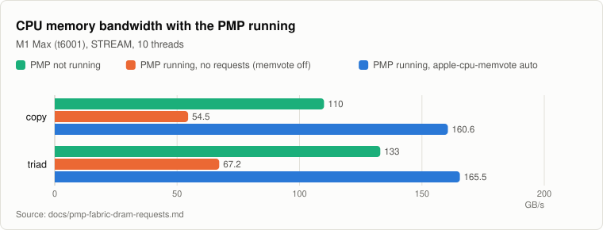
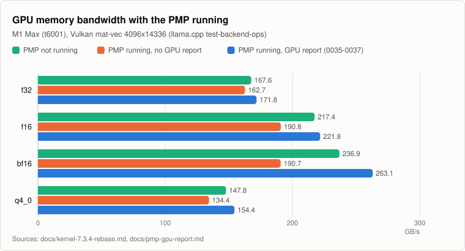
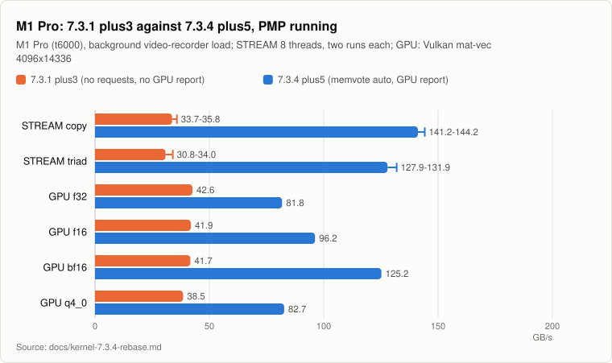
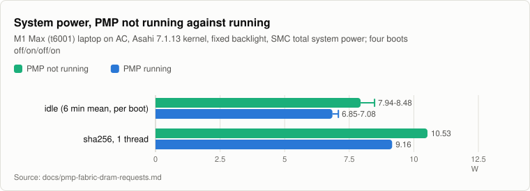
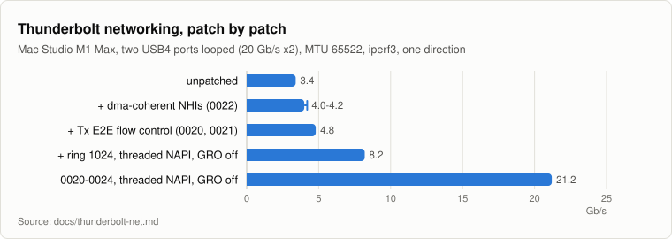
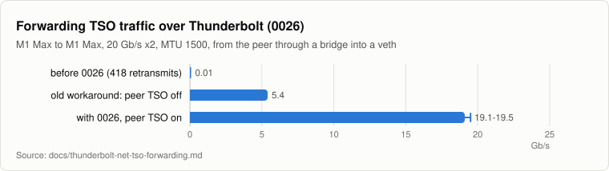
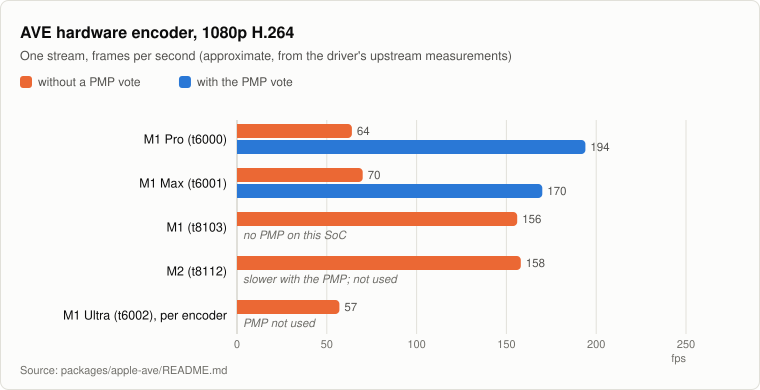
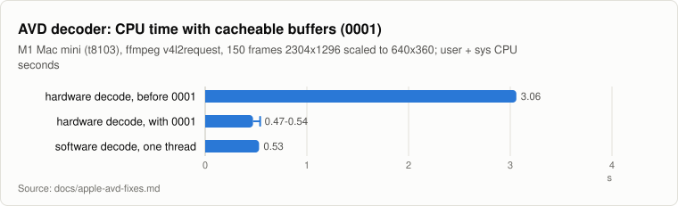

# Benchmarks

What this project's patches and packages change, measured. Every number
here is copied from the document that records the test (named under each
chart, with the machine, the method and the conditions); nothing is
re-measured or estimated on this page.

The charts are drawn by `scripts/bench-charts.py` from
[data/benchmarks.json](data/benchmarks.json), where each value names its
source document. To change a chart, change the source document and the
data file together, then run the script (CI fails if the images do not
match the data). A value written as a range (`4.0-4.2`) is two runs or the
range the source gives; the bar ends at the lower value and a whisker
marks the higher.

Machines are described by model and SoC. "PMP running" means m1n1's stage 2
loads a device tree built with `APPLE_USE_PMP` and Asahi's `pmp` driver
starts the power management coprocessor; Fedora's device trees do not do
that (README, [Power management](../README.md#power-management-pmp)).

## Power management (PMP)

### CPU memory bandwidth

<picture>
  <source media="(prefers-color-scheme: dark)" srcset="img/pmp-cpu-stream-dark.svg">
  
</picture>

With the PMP running and nothing asking it for bandwidth, the fabric and
DRAM controller stay at their lowest levels and CPU bandwidth halves.
`apple-cpu-memvote` (0034) requests bandwidth through the PMP interconnect
provider (0031-0033) while a cluster misses its L1 cache often, which gives
more than the PMP-off figure, with no measurable cost at idle or under
compute-bound load.

| 14" M1 Max, 10 threads, GB/s | PMP not running | PMP running, `mode=off` | PMP running, `mode=auto` |
|---|---|---|---|
| STREAM copy / triad | 110 / 133 | 54.5 / 67.2 | 160.6 / 165.5 |
| 1 thread, copy / triad (`off` and `auto`: on a P cluster) | 52 / 71 | 25.2 / 29.2 | 76.8 / 80.8 |

Source: [pmp-fabric-dram-requests.md](pmp-fabric-dram-requests.md)
(Why, The measurement behind those figures, Testing: final revision).

### GPU memory bandwidth

<picture>
  <source media="(prefers-color-scheme: dark)" srcset="img/pmp-gpu-matvec-dark.svg">
  
</picture>

The PMP has its own bandwidth-driven DVFS for the GPU, but runs it only
for a GPU that has been reported powered on; Asahi's t600x device trees
had no report entry for the GPU. 0035-0037 report it while the GPU driver
is bound.

| 14" M1 Max, Vulkan mat-vec 4096x14336, GB/s | f32 | f16 | bf16 | q4_0 | source |
|---|---|---|---|---|---|
| PMP not running (7.1.13) | 167.6 | 217.4 | 236.9 | 147.8 | [pmp-gpu-report.md](pmp-gpu-report.md) |
| PMP running, no GPU report (7.3.4 `plus5`, entry not yet added) | 162.7 | 190.8 | 190.7 | 134.4 | [kernel-7.3.4-rebase.md](kernel-7.3.4-rebase.md) |
| PMP running, GPU report (7.3.4 `plus5`) | 171.8 | 221.8 | 263.1 | 154.4 | [kernel-7.3.4-rebase.md](kernel-7.3.4-rebase.md) |

The price: about 10 W more under sustained GPU memory load (the PMP's own
policy), none at idle ([pmp-gpu-report.md](pmp-gpu-report.md)).

### M1 Pro: both fixes together

<picture>
  <source media="(prefers-color-scheme: dark)" srcset="img/pmp-m1pro-dark.svg">
  
</picture>

A 14" M1 Pro running a network video recorder, before and after moving
from 7.3.1 `plus3` (no requests, no GPU report) to 7.3.4 `plus5`. With the
PMP running and nothing requesting bandwidth, its GPU was held at about
42 GB/s for every data type.

| 14" M1 Pro, GB/s | 7.3.1 `plus3` | 7.3.4 `plus5` |
|---|---|---|
| GPU mat-vec f32 / f16 / bf16 / q4_0 | 42.6 / 41.9 / 41.7 / 38.5 | 81.8 / 96.2 / 125.2 / 82.7 |
| STREAM 8 threads copy/triad, two runs | 35.8/30.8, 33.7/34.0 | 141.2/131.9, 144.2/127.9 |
| STREAM 1 thread copy/triad | 29.3/24.7 | 83.2/76.7 |

Source: [kernel-7.3.4-rebase.md](kernel-7.3.4-rebase.md#tests-m1-pro-laptop-t6000-pmp-running).

### Power

<picture>
  <source media="(prefers-color-scheme: dark)" srcset="img/pmp-power-dark.svg">
  
</picture>

Why run the PMP at all: about 1.3 W less, idle or busy, on an M1 Max
laptop. The CPU requests cost nothing measurable at idle (6 idle minutes
with `mode=auto` against `mode=off`: 4.81/4.66/4.56 W against
4.79/4.63/4.54 W) or under compute-bound load (sha256 on 10 threads 25.75
against 26.10 W).

| 14" M1 Max, SMC total system power | PMP not running | PMP running |
|---|---|---|
| idle, 6 min mean (median), two boots each | 7.94 (7.90), 8.48 (8.11) W | 6.85 (6.53), 7.08 (6.63) W |
| sha256 1 / 10 threads (same throughput) | 10.53 / 41.8 W | 9.16 / 40.4 W |

Source: [pmp-fabric-dram-requests.md](pmp-fabric-dram-requests.md) (The
measurement behind those figures, Testing).

## Thunderbolt networking

<picture>
  <source media="(prefers-color-scheme: dark)" srcset="img/tbnet-loopback-dark.svg">
  
</picture>

Two USB4 ports of one Mac Studio cabled together (one end in a network
namespace), patch by patch. Mac to Mac (M1 Max Mac Studio to M1 Max
MacBook Pro, MTU 1500): 21.4 / 19.9 Gb/s single stream, 14.7 + 14.2 Gb/s
bidirectional, no lost frames. Source:
[thunderbolt-net.md](thunderbolt-net.md#testing).

<picture>
  <source media="(prefers-color-scheme: dark)" srcset="img/tbnet-forwarding-dark.svg">
  
</picture>

A Mac that bridges its Thunderbolt ports could not forward a peer's TSO
traffic (0026); a lowered MSS on the path, such as an overlay network,
needed 0027 on the sender (a 256 MiB HTTPS upload from 0.96 MB/s to
171.7 MB/s). Source:
[thunderbolt-net-tso-forwarding.md](thunderbolt-net-tso-forwarding.md#testing).

## Video

<picture>
  <source media="(prefers-color-scheme: dark)" srcset="img/ave-encode-dark.svg">
  
</picture>

The AVE encoder driver (`apple-ave`), one 1080p H.264 stream. The encoder's
clock follows a vote to the PMP, so the PMP has to be running for the
faster figures; through this kernel's PMP interconnect provider the vote
gives the same speed and output as the driver's own slot write (M1 Max,
120 frames: 2.43-2.52 s against 2.48-2.49 s, 3.93 s without a vote). The
fps values are the upstream driver's approximate figures. Sources:
[packages/apple-ave/README.md](../packages/apple-ave/README.md),
[apple-ave.md](apple-ave.md).

<picture>
  <source media="(prefers-color-scheme: dark)" srcset="img/avd-cpu-dark.svg">
  
</picture>

The AVD decoder (`dkms-apple-avd`) read decoded frames back through
uncached mappings (about 250 MB/s), so hardware decoding cost more CPU
than software decoding for clients that copy frames. With 0001 the
buffers can be cacheable (read-back 17.9-23.9 GB/s), output bit-identical.
The CPU time is user + sys (2.97 + 0.09 s before; 0.36-0.40 + 0.11-0.14 s
after); the software figure is as the source gives it. Source:
[apple-avd-fixes.md](apple-avd-fixes.md#testing).
