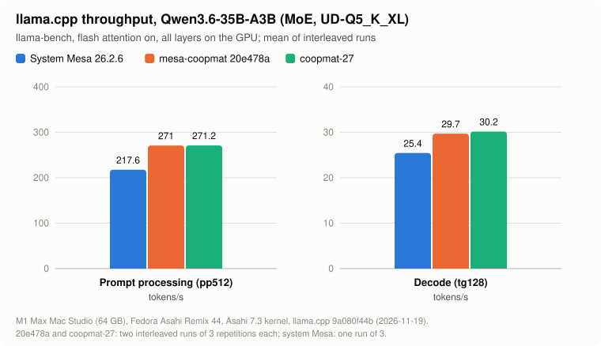
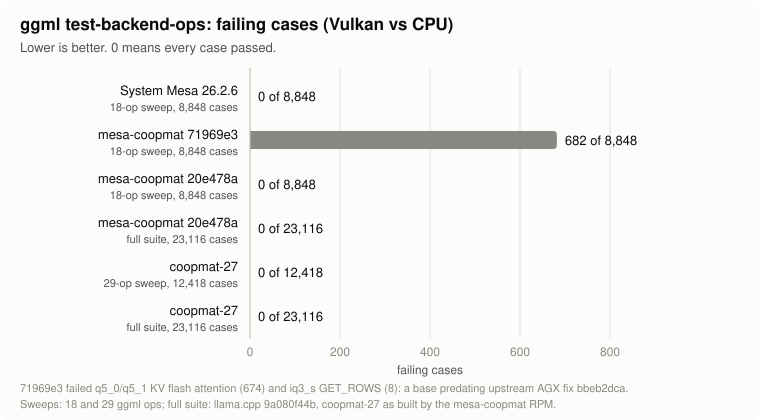

# Honeykrisp with cooperative matrices (mesa-coopmat)

| | |
|---|---|
| package | `mesa-coopmat` ([packages/mesa-coopmat](../packages/mesa-coopmat/README.md)) |
| source | [aquarat/mesa](https://github.com/aquarat/mesa) branch `coopmat-27`, pinned to `5956a5be4777` (tree `a617ac5972a6`) in the spec; no patch files in this repository |
| pull requests | #1 (the package, pin `71969e3`), #16 (pin `20e478a1ab11`: three upstream AGX compiler fixes), #17 (GPU validation of that pin), #26 (pin `5956a5be4777`: the series rebased onto Mesa main 27.0.0-devel) |

## What it does

Mesa's Asahi Vulkan driver (Honeykrisp) built from a Mesa main snapshot
with `VK_KHR_cooperative_matrix`, for GPU compute through ggml
(llama.cpp, stable-diffusion.cpp, CLIP embeddings). It installs into its
own versioned directory with its own ICD file; `with-coopmat <command>`
selects it for one process, and the system Mesa stays everyone else's
driver.

The source is Mesa main `23732583a81c` (2026-11-19, `27.0.0-devel`) plus 42
commits:

- Honeykrisp compute dispatch overlap, and a light in-stream CDM barrier
  for buffer-only compute-to-compute dependencies;
- GPU timing and profiling from the firmware timestamps (`HK_GPUTIME`,
  `HK_PERFTEST`);
- shader-cache key and robustness bounds-check fixes;
- scratch and spill fixes, tessellation, and
  `VK_EXT_fragment_shader_interlock`;
- the prototype `VK_KHR_cooperative_matrix` on the SIMD-group matrix FMA,
  with the native mixed f16 x f16 + f32 FMA and a register allocation fix
  for `simd_matrix_fmadd`.

The fork's README, on its landing page, describes the series commit by
commit, with its knobs and measurements.

### Pin history

| pin | Mesa base | on top |
|---|---|---|
| `71969e3` (#1) | main `063a4640270b`, 2026-08-26, 26.3.0-devel | 39 commits |
| `20e478a1ab11` (#16) | same | the 39, plus three AGX compiler fixes cherry-picked from later main: `bbeb2dca` (!44700, shift-count masking), `bebbaf49` (!44475, phi register shuffling), `b47973d0` (!45571, signext with `abs`) |
| `5956a5be4777` (#26) | main `23732583a81c`, 2026-11-19, 27.0.0-devel | 42 commits: the 39, plus the light dependency barrier (3 commits, aquarat/mesa PR #1). The three cherry-picks are upstream now and were dropped. |

## Why

Cooperative matrices let ggml's Vulkan backend use the GPU's SIMD-group
matrix units:

<picture>
  <source media="(prefers-color-scheme: dark)" srcset="img/mesa-coopmat-throughput-dark.svg">
  
</picture>

| tokens/s, M1 Max, Qwen3.6-35B-A3B UD-Q5_K_XL | system Mesa 26.2.6 | `20e478a1ab11` | `5956a5be4777` |
|---|---:|---:|---:|
| prompt processing, pp512 | 217.6 | 271.0 | 271.2 |
| decode, tg128 | 25.45 | 29.71 | 30.18 |

The second pin (#16) fixed correctness: `test-backend-ops` on the first pin
failed 682 of 8848 cases, because its base predated an AGX shift-masking
fix. The third pin moves to current Mesa main, so later upstream fixes come
with the base instead of as cherry-picks, and it adds the light dependency
barrier (decode +1.2 to +2.6 % in earlier A/B runs; +1.6 % against
`20e478a1ab11` here).

## Design and alternatives

- **Pin a commit and verify it.** `scripts/make-srpm.sh mesa-coopmat`
  fetches only the pinned commit and refuses it unless its tree id and
  `VERSION` match the spec. A `PROVENANCE` file records commit, tree, upstream
  base and the driver's SHA-256. For this pin, Source0 has the same SHA-256
  (`3ff2a7c4…`) whether fetched from GitHub or from a local clone.
- **Opt-in per process, versioned paths.** Nothing goes in `icd.d` or
  `/usr/bin`. The versioned directory changes with each pin; the wrapper
  path does not. A service that must not change driver silently can name the
  versioned ICD path, and then fails to find a GPU after an upgrade instead
  of running a different driver.
- **Rebase onto Mesa main rather than keep cherry-picking.** The series
  depends on Mesa main, so it cannot move onto a 26.2 release mechanically.
  It was rebased onto current main as a new branch, `coopmat-27`. The old
  branch, `coopmat`, stays at `20e478a1ab11` for reference and rollback.
  Commits already upstream were dropped. One conflict needed resolving: a
  one-line argument change in KosmicKrisp's `kk_shader.c`, which upstream
  had restructured. Every other commit applied unchanged.

## Testing

#1, #16 and #17 are described in those pull requests, and their results
are summarised in the package README. For #26, pin `5956a5be4777`, on an M1
Max Mac Studio (kernel 7.3.4 `plus5`) and an M1 Max MacBook Pro (a 7.1.13
Asahi kernel), with llama.cpp `9a080f44b` (2026-11-19):

- The SRPM tree check passes, and an `rpmbuild --rebuild` in a Fedora 44
  container passes `%check`. The installed driver's SHA-256 is
  `685f29cf…` (in `PROVENANCE`).
- `vulkaninfo` lists `VK_KHR_cooperative_matrix` (rev 2) and the driver
  reports `Mesa 27.0.0-devel (git-5956a5be47)`.
- `test-backend-ops -b Vulkan0` against the CPU backend:
  - the full suite (23,116 cases) passes 23,116/23,116 with the RPM's driver;
  - the 29-operation sweep passes 12,418/12,418;
  - one run of a local build failed one `SET_ROWS f32 -> q2_0` case. That
    case fails intermittently on every driver, because the test's inputs
    are random and the CPU and GPU can round a tie differently: in 100
    repeated runs each, `20e478a1ab11` failed 2, upstream Mesa main 2 and
    this pin 1.
- Against `20e478a1ab11` on Qwen3.6-35B-A3B:
  - prefill-shaped logits (4 x 2048 tokens): mean KL divergence about 0
    (-8e-6), same top token 100 %, perplexity ratio
    1.000106 ± 0.000082;
  - decode-shaped logits (2 x 512 tokens, batch 1): maximum KL divergence
    0.000043, same top token 100 %;
  - greedy text for three prompts: identical.

  The logits are not bit-identical, because the 5,333 upstream commits
  between the two bases include compiler changes.
- dEQP-VK 1.4.7.1 `compute.pipeline.*` (22,533 cases): 0 failures and 0
  crashes, the same as upstream Mesa main built without the series.
  coopmat-27 passes three more cases (`replicated_composites_coopmat_*`).
  Of the 17,924 cooperative-matrix cases, 520 pass, 0 fail and the rest are
  not supported; this is identical to `20e478a1ab11`.
- There were no kernel GPU faults, timeouts or hangs during any of these
  runs.

<picture>
  <source media="(prefers-color-scheme: dark)" srcset="img/mesa-coopmat-tbo-dark.svg">
  
</picture>

The chart data are in [data/mesa-coopmat-charts.json](data/mesa-coopmat-charts.json);
the SVGs are drawn by `.github/readme/gen_charts.py` in the aquarat/mesa fork.

## Limitations and open items

- `VK_KHR_cooperative_matrix` here is a prototype from a personal branch,
  not upstream Mesa. Problems go to this project, not to Mesa.
- It is a Mesa main snapshot, not Fedora's Mesa. The Asahi DRM uAPI it uses
  is unchanged in the kernels this project builds.
- The light dependency barrier word (0x17f) is a superset of a word that
  passed long CTS runs. However, dEQP exercises the new path only lightly,
  and an under-flushing barrier would fail rarely and nondeterministically.
  `HK_PERFTEST=fullbarrier` restores the full barrier for one process.
- Hosts still on the first pin (`71969e3`) keep its q5 KV and `iq3_s`
  failures. Hosts on `20e478a1ab11` are unaffected by this pull request
  until they upgrade. A service that names the versioned ICD path, or is
  version-locked, must be repointed when upgrading.
- Long-running ggml jobs have been run with
  `GGML_VK_MAX_NODES_PER_SUBMIT=1`, which is a ggml setting, not part of the
  driver.

## Hardware

M1 and M2 GPUs. Tested on t6001 (M1 Max) and, for earlier pins, t6000
(M1 Pro).

## Upstream status and provenance

Mesa code under MIT. The base is upstream Mesa (authorship in Mesa's
history). The 42 commits on top are on the personal branch and are not
submitted upstream. They were developed with LLM assistance. Mesa requires
AI involvement to be disclosed and keeps AI-made changes out of `src/asahi`
(`docs/submittingpatches.rst` and `AGENTS.md` in Mesa). The Asahi Linux
project forbids generative-AI tooling for material contributions
(https://asahilinux.org/llm-policy/). The fork's README states this.
